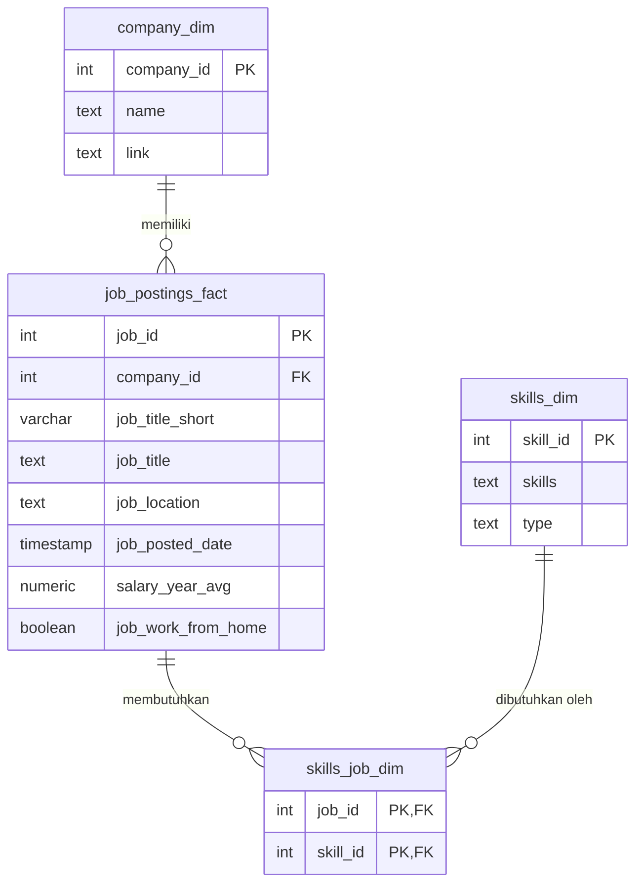

# 📊 Analisis Pasar Kerja Data Analyst dengan SQL

Proyek ini menganalisis data lowongan kerja tahun 2023 untuk menjawab satu pertanyaan utama:

> **Skill apa yang paling layak dipelajari oleh seorang Data Analyst, yaitu skill yang banyak dicari *dan* bergaji tinggi?**

Seluruh analisis dikerjakan dengan **PostgreSQL**. Data lowongan dimodelkan dalam skema bintang (*star schema*) lalu dijawab lewat lima query yang saling melanjutkan, dari pekerjaan bergaji tertinggi sampai skill yang paling optimal.

🔍 Semua query ada di folder [`Project_sql/`](Project_sql/).

---

## 📌 Daftar Isi

- [Latar Belakang](#-latar-belakang)
- [Tools yang Digunakan](#️-tools-yang-digunakan)
- [Struktur Database](#️-struktur-database)
- [Analisis](#-analisis)
  - [1. Pekerjaan Data Analyst dengan Gaji Tertinggi](#1-pekerjaan-data-analyst-dengan-gaji-tertinggi)
  - [2. Skill untuk Pekerjaan Bergaji Tertinggi](#2-skill-untuk-pekerjaan-bergaji-tertinggi)
  - [3. Skill yang Paling Banyak Dicari](#3-skill-yang-paling-banyak-dicari)
  - [4. Skill dengan Rata-rata Gaji Tertinggi](#4-skill-dengan-rata-rata-gaji-tertinggi)
  - [5. Skill Paling Optimal untuk Dipelajari](#5-skill-paling-optimal-untuk-dipelajari)
- [Kesimpulan](#-kesimpulan)
- [Yang Saya Pelajari](#-yang-saya-pelajari)
- [Cara Menjalankan Proyek](#-cara-menjalankan-proyek)
- [Struktur Repository](#-struktur-repository)

---

## 💡 Latar Belakang

Pasar kerja di bidang data terus berkembang, tetapi daftar skill yang diminta di setiap lowongan sangat beragam. Bagi orang yang baru memulai karier sebagai Data Analyst, sulit menentukan skill mana yang sebaiknya diprioritaskan.

Proyek ini mencoba menjawabnya dengan data. Lima pertanyaan yang saya jawab:

1. Pekerjaan Data Analyst mana yang gajinya paling tinggi?
2. Skill apa yang dibutuhkan oleh pekerjaan-pekerjaan bergaji tinggi tersebut?
3. Skill apa yang paling banyak dicari?
4. Skill apa yang berkaitan dengan gaji paling tinggi?
5. Skill apa yang paling optimal untuk dipelajari (permintaannya tinggi *dan* gajinya tinggi)?

---

## 🛠️ Tools yang Digunakan

| Tool | Kegunaan |
|---|---|
| **SQL** | Bahasa utama untuk mengolah dan menganalisis data |
| **PostgreSQL** | Sistem manajemen database untuk menyimpan data lowongan |
| **pgAdmin** | Mengelola database dan memuat data CSV |
| **Visual Studio Code** | Menulis dan menjalankan query SQL |
| **Git & GitHub** | Version control dan publikasi proyek |

---

## 🗄️ Struktur Database

Data disusun dalam **star schema**, dengan satu tabel fakta (`job_postings_fact`) yang terhubung ke tabel-tabel dimensi. Tabel `skills_job_dim` menjadi tabel penghubung untuk relasi *many-to-many* antara lowongan dan skill.



Skema lengkapnya, termasuk *foreign key* dan *index* untuk mempercepat join, ada di [`sql_load/2_create_tables.sql`](sql_load/2_create_tables.sql).

---

## 🔎 Analisis

Setiap query fokus pada satu pertanyaan. Kecuali disebutkan lain, analisis dibatasi pada lowongan **Data Analyst** yang **bisa dikerjakan remote** (`job_location = 'Anywhere'`) dan **mencantumkan gaji tahunan**.

### 1. Pekerjaan Data Analyst dengan Gaji Tertinggi

📄 [`1_top_paying_job.sql`](Project_sql/1_top_paying_job.sql)

Saya mengambil 10 lowongan Data Analyst remote dengan gaji rata-rata tahunan tertinggi, lalu menggabungkannya (`LEFT JOIN`) dengan tabel perusahaan untuk menampilkan nama perusahaannya.

```sql
SELECT
    job.job_title,
    job.salary_year_avg,
    job.job_location,
    job.job_posted_date,
    comp.name AS company
FROM job_postings_fact AS job
LEFT JOIN company_dim AS comp
    ON comp.company_id = job.company_id
WHERE
    job.job_title_short = 'Data Analyst'
    AND job.job_location = 'Anywhere'
    AND job.salary_year_avg IS NOT NULL
ORDER BY job.salary_year_avg DESC
LIMIT 10;
```

| # | Posisi | Perusahaan | Gaji / Tahun (USD) |
|---|---|---|---:|
| 1 | Data Analyst | Mantys | 650,000 |
| 2 | Director of Analytics | Meta | 336,500 |
| 3 | Associate Director - Data Insights | AT&T | 255,830 |
| 4 | Data Analyst, Marketing | Pinterest | 232,423 |
| 5 | Data Analyst (Hybrid/Remote) | UCLA Health | 217,000 |
| 6 | Principal Data Analyst (Remote) | SmartAsset | 205,000 |
| 7 | Director, Data Analyst - HYBRID | Inclusively | 189,309 |
| 8 | Principal Data Analyst, AV Performance Analysis | Motional | 189,000 |
| 9 | Principal Data Analyst | SmartAsset | 186,000 |
| 10 | ERM Data Analyst | Get It Recruit - IT | 184,000 |

**Insight:**
- **Rentang gaji sangat lebar**, dari $184.000 sampai $650.000. Angka $650.000 dari Mantys jauh di atas posisi lainnya dan kemungkinan besar merupakan *outlier*.
- **Perusahaannya beragam**: teknologi (Meta, Pinterest), telekomunikasi (AT&T), kesehatan (UCLA Health), sampai otomotif (Motional). Artinya kebutuhan Data Analyst tersebar di banyak industri.
- **Senioritas berpengaruh besar.** Banyak posisi teratas berlevel *Director*, *Principal*, atau *Associate Director*.

### 2. Skill untuk Pekerjaan Bergaji Tertinggi

📄 [`2_top_paying_job_skill.sql`](Project_sql/2_top_paying_job_skill.sql)

Hasil query pertama saya simpan dalam **CTE** (`WITH top_paying_jobs AS (...)`), lalu saya gabungkan dengan tabel skill untuk melihat skill apa yang diminta oleh tiap pekerjaan.

```sql
WITH top_paying_jobs AS (
    SELECT
        job.job_id,
        job.job_title,
        job.salary_year_avg,
        comp.name AS company
    FROM job_postings_fact AS job
    LEFT JOIN company_dim AS comp
        ON comp.company_id = job.company_id
    WHERE
        job.job_title_short = 'Data Analyst'
        AND job.job_location = 'Anywhere'
        AND job.salary_year_avg IS NOT NULL
    ORDER BY job.salary_year_avg DESC
    LIMIT 10
)
SELECT
    top.*,
    skills_dim.skills
FROM top_paying_jobs AS top
INNER JOIN skills_job_dim
    ON top.job_id = skills_job_dim.job_id
INNER JOIN skills_dim
    ON skills_job_dim.skill_id = skills_dim.skill_id
ORDER BY top.salary_year_avg DESC;
```

Dari 10 pekerjaan tersebut, 8 di antaranya mencantumkan skill. Berikut skill yang paling sering muncul:

| Skill | Muncul di (dari 8 lowongan) |
|---|---:|
| SQL | 8 |
| Python | 7 |
| Tableau | 6 |
| R | 4 |
| Snowflake | 3 |
| Pandas | 3 |
| Excel | 3 |

**Insight:**
- **SQL muncul di semua lowongan** bergaji tertinggi yang mencantumkan skill, jadi SQL adalah syarat dasar.
- **Python (7 dari 8)** dan **Tableau (6 dari 8)** menyusul. Kombinasi bahasa pemrograman dan tools visualisasi menjadi standar di level atas.
- Skill **cloud dan data platform** (Snowflake, Azure, AWS, Databricks) serta **tools kolaborasi** (Jira, Confluence, Bitbucket) juga mulai muncul di posisi senior.

### 3. Skill yang Paling Banyak Dicari

📄 [`3_top_demands_skill.sql`](Project_sql/3_top_demands_skill.sql)

Query ini menghitung berapa kali setiap skill muncul di seluruh lowongan, tanpa batasan lokasi atau gaji, menggunakan `COUNT` dan `GROUP BY`.

```sql
SELECT
    skills_dim.skills,
    COUNT(skills_job_dim.skill_id) AS demand_count
FROM job_postings_fact AS top
INNER JOIN skills_job_dim
    ON top.job_id = skills_job_dim.job_id
INNER JOIN skills_dim
    ON skills_job_dim.skill_id = skills_dim.skill_id
WHERE job_title_short = 'Data Analyst'
GROUP BY skills
ORDER BY demand_count DESC
LIMIT 5;
```

| Skill | Jumlah Lowongan |
|---|---:|
| SQL | 92,628 |
| Excel | 67,031 |
| Python | 57,326 |
| Tableau | 46,554 |
| Power BI | 39,468 |

**Insight:**
- **SQL dan Excel adalah skill dasar** yang paling banyak diminta. Keduanya penting untuk mengolah data dan membuat spreadsheet.
- **Python** ada di urutan ketiga, jadi kemampuan pemrograman makin dibutuhkan untuk analisis yang lebih kompleks.
- **Tableau dan Power BI** melengkapi lima besar, yang menunjukkan pentingnya visualisasi data dan *business intelligence*.

### 4. Skill dengan Rata-rata Gaji Tertinggi

📄 [`4_top_paying_skill.sql`](Project_sql/4_top_paying_skill.sql)

Untuk setiap skill, saya menghitung rata-rata gaji (`AVG`) dari lowongan Data Analyst remote yang membutuhkannya, lalu mengurutkan 25 skill teratas.

```sql
SELECT
    skills_dim.skills,
    AVG(top.salary_year_avg) AS average_salary
FROM job_postings_fact AS top
INNER JOIN skills_job_dim
    ON top.job_id = skills_job_dim.job_id
INNER JOIN skills_dim
    ON skills_job_dim.skill_id = skills_dim.skill_id
WHERE job_title_short = 'Data Analyst'
    AND top.salary_year_avg IS NOT NULL
    AND job_location = 'Anywhere'
GROUP BY skills
ORDER BY average_salary DESC
LIMIT 25;
```

10 skill teratas:

| Skill | Rata-rata Gaji (USD) |
|---|---:|
| PySpark | 208,172 |
| Bitbucket | 189,155 |
| Couchbase | 160,515 |
| Watson | 160,515 |
| DataRobot | 155,486 |
| GitLab | 154,500 |
| Swift | 153,750 |
| Jupyter | 152,777 |
| Pandas | 151,821 |
| Elasticsearch | 145,000 |

**Insight:**
- **Big data dan machine learning dibayar paling tinggi.** PySpark, Watson, dan DataRobot menunjukkan bahwa analyst yang bisa mengolah data skala besar atau menerapkan model prediktif mendapat gaji premium.
- **Ekosistem Python** (Pandas, NumPy, Jupyter, scikit-learn) konsisten muncul di daftar gaji tinggi.
- **Tools DevOps dan version control** (Bitbucket, GitLab, Jenkins, Kubernetes) juga bergaji tinggi. Analyst yang paham alur kerja engineering lebih dihargai.

### 5. Skill Paling Optimal untuk Dipelajari

📄 [`5_optimal_skill.sql`](Project_sql/5_optimal_skill.sql)

Ini adalah gabungan dari query 3 dan 4. Saya menghitung **rata-rata gaji** sekaligus **jumlah permintaan** untuk setiap skill, lalu memakai `HAVING` agar hanya skill yang muncul di lebih dari 10 lowongan yang ikut dihitung. Dengan begitu, skill yang langka tetapi kebetulan bergaji tinggi tidak ikut terbawa.

```sql
SELECT
    skills_dim.skills,
    ROUND(AVG(salary_year_avg), 0) AS average_salary,
    COUNT(skills_job_dim.skill_id) AS skill_count
FROM job_postings_fact
INNER JOIN skills_job_dim
    ON job_postings_fact.job_id = skills_job_dim.job_id
INNER JOIN skills_dim
    ON skills_job_dim.skill_id = skills_dim.skill_id
WHERE job_title_short = 'Data Analyst'
    AND job_postings_fact.salary_year_avg IS NOT NULL
    AND job_postings_fact.job_location = 'Anywhere'
GROUP BY skills_dim.skills
HAVING COUNT(skills_job_dim.skill_id) > 10
ORDER BY average_salary DESC, skill_count DESC
LIMIT 25;
```

| Skill | Rata-rata Gaji (USD) | Jumlah Lowongan |
|---|---:|---:|
| Go | 115,320 | 27 |
| Confluence | 114,210 | 11 |
| Hadoop | 113,193 | 22 |
| Snowflake | 112,948 | 37 |
| Azure | 111,225 | 34 |
| BigQuery | 109,654 | 13 |
| AWS | 108,317 | 32 |
| Looker | 103,795 | 49 |
| **Python** | **101,397** | **236** |
| **R** | **100,499** | **148** |
| **Tableau** | **99,288** | **230** |
| **SAS** | **98,902** | **126** |
| **Power BI** | **97,431** | **110** |

**Insight:**
- **Python dan Tableau adalah pilihan paling aman.** Keduanya muncul di lebih dari 230 lowongan dengan gaji rata-rata sekitar $100.000.
- **Skill cloud** (Snowflake, Azure, AWS, BigQuery) memberi gaji lebih tinggi dengan permintaan yang lumayan. Cocok sebagai skill lanjutan setelah fondasi kuat.
- **R, SAS, dan Power BI** tetap relevan, dengan permintaan di atas 100 lowongan.

---

## ✅ Kesimpulan

1. **SQL adalah fondasi.** SQL diminta oleh semua pekerjaan bergaji tertinggi dan menjadi skill yang paling banyak dicari untuk Data Analyst (92.628 lowongan).
2. **Python adalah investasi terbaik setelah SQL.** Di lowongan remote yang mencantumkan gaji, Python paling banyak diminta (236 lowongan) dengan gaji rata-rata di atas $100.000.
3. **Excel dan visualisasi tetap penting.** Excel adalah skill kedua yang paling banyak dicari, sedangkan Tableau dan Power BI muncul konsisten di semua sisi analisis.
4. **Cloud dan big data menaikkan nilai jual.** Snowflake, Azure, AWS, dan PySpark berkaitan dengan gaji di atas rata-rata.
5. **Senioritas dan spesialisasi menentukan gaji tertinggi.** Posisi teratas didominasi level Principal dan Director.

Berdasarkan hasil ini, urutan belajar yang saya rekomendasikan untuk calon Data Analyst adalah:

```
SQL  →  Python  →  Tableau / Power BI  →  Cloud (Snowflake / AWS / Azure)
```

---

## 📚 Yang Saya Pelajari

Lewat proyek ini saya mempraktikkan:

- **Desain database relasional**: membuat tabel dengan `PRIMARY KEY`, `FOREIGN KEY`, *composite key*, dan `INDEX`.
- **Memuat data** dari file CSV ke PostgreSQL dengan perintah `COPY`.
- **Menggabungkan tabel** dengan `INNER JOIN` dan `LEFT JOIN`, termasuk lewat tabel penghubung *many-to-many*.
- **Agregasi data** dengan `COUNT`, `AVG`, `ROUND`, `GROUP BY`, dan `HAVING`.
- **Common Table Expressions (CTE)** untuk membuat query bertahap yang mudah dibaca.
- **Berpikir analitis**: mengubah pertanyaan bisnis menjadi query, lalu menerjemahkan hasilnya menjadi insight.

---

## 🚀 Cara Menjalankan Proyek

**Prasyarat:** PostgreSQL dan pgAdmin (atau klien SQL lain) sudah terpasang.

1. **Clone repository ini**
   ```bash
   git clone https://github.com/alfahamiey/<nama-repo>.git
   ```

2. **Buat database**, jalankan [`sql_load/1_create_database.sql`](sql_load/1_create_database.sql).

3. **Buat tabel**, jalankan [`sql_load/2_create_tables.sql`](sql_load/2_create_tables.sql) pada database `sql_course`.

4. **Muat data CSV.** File CSV tidak disertakan di repository ini karena ukurannya besar. Siapkan empat file berikut:
   - `company_dim.csv`
   - `skills_dim.csv`
   - `job_postings_fact.csv`
   - `skills_job_dim.csv`

   Lalu sesuaikan path file di [`sql_load/3_modify_tables.sql`](sql_load/3_modify_tables.sql) dan jalankan skrip tersebut. Jika muncul error *permission denied*, ikuti petunjuk alternatif dengan `\copy` di bagian atas file itu.

5. **Jalankan query analisis** di folder [`Project_sql/`](Project_sql/) secara berurutan.

---

## 📁 Struktur Repository

```
.
├── Project_sql/                     # Query analisis
│   ├── 1_top_paying_job.sql
│   ├── 2_top_paying_job_skill.sql
│   ├── 3_top_demands_skill.sql
│   ├── 4_top_paying_skill.sql
│   └── 5_optimal_skill.sql
├── sql_load/                        # Setup database
│   ├── 1_create_database.sql
│   ├── 2_create_tables.sql
│   └── 3_modify_tables.sql
└── README.md
```

---

## 🙏 Kredit

Dataset dan struktur proyek berasal dari kursus **SQL for Data Analytics** oleh [Luke Barousse](https://github.com/lukebarousse). Semua query dan analisis di repository ini saya tulis sendiri sebagai bagian dari proses belajar.

---

## 📬 Kontak

Terbuka untuk diskusi, masukan, maupun peluang kolaborasi.

- **GitHub**: [@alfahamiey](https://github.com/alfahamiey)
- **LinkedIn**: *(tambahkan link LinkedIn kamu)*
- **Email**: *(tambahkan email kamu)*
